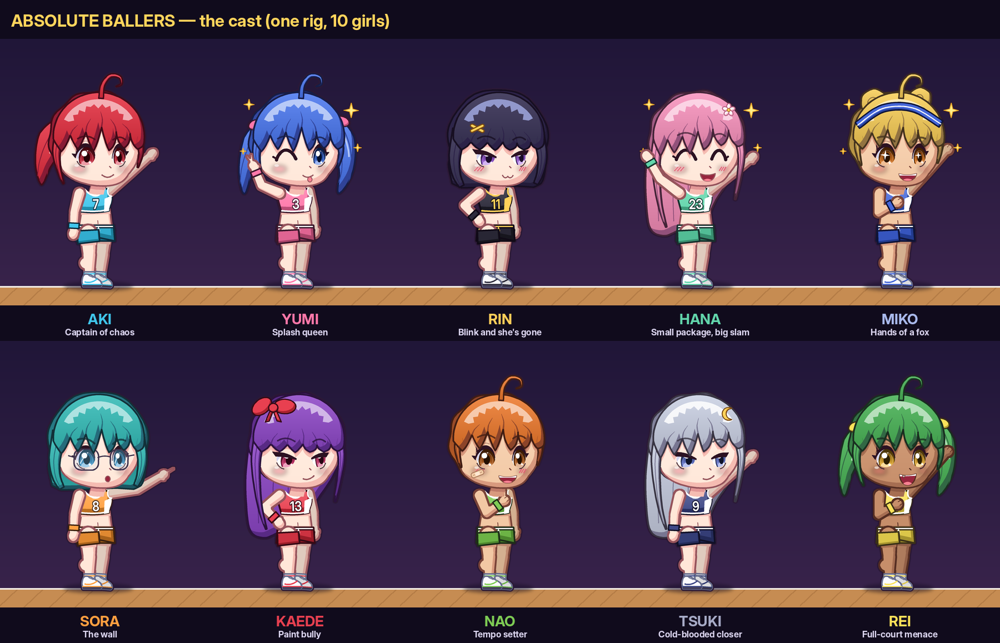
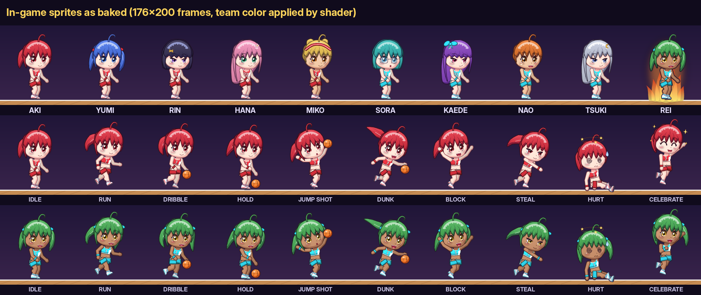

# Absolute Ballers

2D anime arcade basketball in the spirit of NBA Jam: exaggerated
physics, big dunks, shot-timing meter, and the "SHE'S ON FIRE!" streak.
Original anime-styled ballers, 3v3 full court by default (1v1 / 2v2 / 5v5
selectable from the main menu — team size is pure data).

Built with **Godot 4.3+** and GDScript. No third-party addons required.

## Running it

1. Open the project folder in Godot 4.3 or newer (first open imports the
   sprite sheets and WAVs — let the import finish before playing).
2. Press F5. Boot -> main menu -> EXHIBITION, TOURNAMENT, or WATCH DEMO
   (AI vs AI attract mode — a quick way to verify everything works).

The girls are baked from a code-driven chibi rig (see below). The arena art
and the audio are still generated placeholders; final versions drop in
without code changes.

### If the game doesn't load

- Check the **Output** and **Debugger > Errors** panels — script errors and
  missing-asset messages land there, and `Art`/`AudioManager` log the exact
  paths they could not load (missing textures render magenta instead of
  crashing).
- First open must finish **importing** (progress bar in the editor) before
  F5; if you played too early, close the game, wait, and run again.
- If scripts show "could not resolve class" errors on a fresh clone, use
  Project > Reload Current Project once so the script class cache rebuilds.
- Still stuck: copy the first few red lines from the Output panel into the
  session — the exact text pinpoints the file.

## Menu

`SINGLE PLAYER` (Quick Match or Tournament — auto-seats you on team 0, no
lobby), `VERSUS` (couch lobby, 2-4 humans), `OPTIONS` (team size, quarter
length, difficulty, on-fire mode, shot clock, control hints, plus **How to
Play** and **Watch Demo**), `QUIT`. In single player, keyboard and gamepad
both drive your baller at once — grab whichever.

## Controls

| Action | Keyboard | Gamepad |
| --- | --- | --- |
| Move | WASD / arrows | Left stick / d-pad |
| Shoot / Block (context) | K or Space | A |
| Pass / Steal (context) | J | B |
| Turbo | L or Shift | X or right trigger |
| Switch to nearest teammate | I | Y |
| Pause | Esc / P | Start |

A live hint bar at the bottom of the screen shows what SHOOT and PASS do in
your current situation (toggle in Options).

Context rules (NBA Jam classic): with the ball, SHOOT jumps and charges the
meter — release at the apex for a perfect shot; near the rim it becomes a
dunk. On defense the same button is a block jump, and PASS becomes a steal
swipe (hold TURBO while swiping to shove — knockdowns are legal here).

**Local multiplayer:** 2-4 humans (keyboard + up to 3 pads, or 4 pads). In
SQUAD SELECT every device presses SHOOT to join a seat, picks a side and a
baller, and locks in. Remaining roster slots are AI-filled.

## Match rules

- 4 quarters x 2:00 by default (configurable in the menu), sudden-death OT.
- Every quarter-1 and overtime starts with a live jump-ball toss.
- No fouls, no free throws, no out-of-bounds. **Goaltending is legal** —
  time a block jump near the rim to swat shots out of the air, even ones
  that were going in.
- **Alley-oops:** a long pass (240+ units) to a teammate standing in dunk
  range converts straight into a slam.
- **Buzzer beaters:** the clock can hit zero while a shot flies — the
  quarter waits for the ball ("AT THE BUZZER!").
- Shot clock optional (off by default); AI panics and hoists when it's low.
- **On fire:** 3 consecutive personal buckets ignites a baller — speed and
  shot boosts, aura + ember trail, unlimited turbo — until the other team
  scores or she burns out (4 baskets). A per-TEAM fire variant can be
  toggled in the menu.
- Full box score at the end: points, dunks, threes, steals, blocks; MVP is
  hustle-weighted, not just points. Career W-L record shows on the menu.

## Repository layout

```
assets/characters/    baked chibi sprite sheets (+ team-kit layers)
assets/fx/            baked ball spin + fire aura strips
assets/placeholder/   generated arena art (court, crowd, hoop, markers) + SFX
data/characters/      one .tres per baller — stats, sprite sheet paths
data/teams/           one .tres per franchise — name, colors
docs/                 design decisions, architecture, asset + Steam notes
scenes/               boot.tscn (screens are built in code for now)
scripts/
  core/               autoloads (EventBus, Game, input), settings, config
  data/               CharacterDef / TeamDef / roster loading
  match/              the whole on-court sim + visuals + HUD + camera
  ai/                 TeamAI coordinator (marks, spacing, difficulty)
  tournament/         single-elimination bracket state
  steam/              GodotSteam scaffold + achievement stubs
  ui/                 main menu, squad-select lobby, bracket screen
tools/
  chibi_rig/          the character art pipeline (rig, poses, faces, bake)
  generate_*.py       arena placeholder art + procedural SFX
```

## Character art (chibi rig)

The girls are drawn by a code-driven **chibi cutout rig** (the Spine /
gacha battle-sprite technique) and baked into the game's sprite sheets with
`python3 -m tools.chibi_rig bake`. Uniforms take the team color at runtime
through a shader. See [`docs/ART_DIRECTION.md`](docs/ART_DIRECTION.md),
[`docs/ASSET_PIPELINE.md`](docs/ASSET_PIPELINE.md) and the previews in
[`docs/art/`](docs/art/).




## Arena art + audio pipeline

`python3 tools/generate_placeholders.py` (needs Pillow) regenerates the
court, crowd, hoop and markers; `python3 tools/generate_audio.py` (no deps)
regenerates every sound effect. Sound filenames in
`assets/placeholder/audio/` are the audio contract — final assets that
follow them are drop-in replacements. The character sheet contract is
generated by the bake (`scripts/match/baller_sheet.gd`).

## Roadmap

1. ~~Project scaffold~~ ✅
2. ~~Vertical slice: movement, ball physics, shot meter, scoring, camera~~ ✅
3. ~~Full team AI, full court, configurable team size~~ ✅
4. ~~On fire + announcer popups~~ ✅
5. ~~Local multiplayer (multi-gamepad lobby)~~ ✅
6. ~~Tournament bracket~~ ✅
7. ~~Steam scaffolding (stubs)~~ ✅
8. ~~Arcade juice: SFX, tip-off jump ball, camera shake, gamepad rumble,
   flaming ball FX, box score, demo mode~~ ✅
9. ~~Gameplay depth: alley-oops, goaltend swats, buzzer beaters, hit-stop,
   full stat lines + hustle-weighted MVP, smarter defense (lane denial,
   rim protection, shot-clock panic), how-to-play screen, career record,
   restart option~~ ✅
10. ~~Low-angle court, parallax crowd, new menu, single-player flow~~ ✅
11. ~~Chibi rig art direction: rig renderer, 5-girl cast, expression
    library, move set~~ ✅ (`docs/ART_DIRECTION.md`)
12. ~~Chibi rig in the game: 10-girl cast, baked sprite sheets with
    team-colored kits, frame-synced shots/dunks, ball in hand~~ ✅
13. **Next:** an arena art pass to match the girls (court, crowd, hoops,
    UI portraits), then a gameplay/feel pass (defense is too soft:
    simulated games run 80–130 pts).
14. Post-v1: **online multiplayer** via GodotSteam P2P — architecture notes
    in `docs/ONLINE_MULTIPLAYER.md`; music pass + real sound design;
    polish (half-court side switch at halftime, unlockable ballers).
